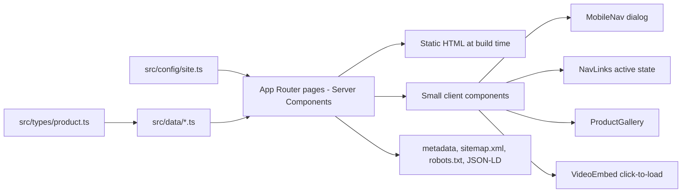

# Nesday Coconut Scraper Website: Project Documentation

This document explains what the website does, how it is built, how to run and change it, and what must happen before launch. It is written so that a developer who has never seen the project can maintain it.

---

## 1. Project overview and goals

**Nesday Electric Coconut Scraper** is a household electric kitchen tool made by **Biars Industries** in Koothattukulam, Ernakulam, Kerala. It has a handheld unit with a rotating stainless steel shredder head, powered by a separate adapter unit. It comes with attachments for beating curd, beating eggs and sharpening knives.

This website replaces the previous WordPress site at `nesdaycoconutscraper.in`. Goals:

- Explain the product, its attachments and how to use it safely.
- Build customer confidence with accurate, verified information.
- Make it easy to order, which for now means **calling the business**.
- Be fast, accessible, mobile-friendly and easy to maintain.

**Important finding about the old site:** the previous WordPress site has been **compromised**. Its homepage contains injected Greek casino content and dozens of spam backlinks. Its "Shop" page contains only theme demo products (for example "Package 1, $12" and a lorem-ipsum "Unlimited Box"), so it has no real prices. None of that content was reused. See section 26.

## 2. Website pages and features

| URL                                  | Page                        | Notes                                                                                                                            |
| ------------------------------------ | --------------------------- | -------------------------------------------------------------------------------------------------------------------------------- |
| `/`                                  | Homepage                    | Announcement bar, hero, benefits, product showcase, attachments, how it works, specifications, videos, FAQ, final call to action |
| `/products`                          | Product listing             | Works for one product or many                                                                                                    |
| `/products/electric-coconut-scraper` | Product detail              | Gallery, price/availability, features, attachments, specifications, usage and cleaning, warranty, FAQ                            |
| `/how-it-works`                      | How It Works / Instructions | Operating steps, safety instructions, maintenance, environmental protection, support                                             |
| `/about`                             | About Us                    | Verified brand and company information only                                                                                      |
| `/contact`                           | Contact                     | Phone number only, as instructed by the business                                                                                 |
| `/policies/warranty`                 | Warranty                    | Verified text from the old site                                                                                                  |
| `/policies/shipping`                 | Shipping and Delivery       | Marked "pending business review"                                                                                                 |
| `/policies/returns`                  | Returns and Refunds         | Marked "pending business review"                                                                                                 |
| `/policies/privacy`                  | Privacy Policy              | Accurate description of what the site does; marked for legal review                                                              |
| `/policies/terms`                    | Terms and Conditions        | Marked "pending business review"                                                                                                 |
| `/sitemap.xml`, `/robots.txt`        | SEO files                   | Generated from the data modules                                                                                                  |
| Any other URL                        | 404 page                    | Friendly "page not found" with links back                                                                                        |

**Deliberately not included:**

- **Testimonials.** No authentic, approved reviews exist, so the section is omitted rather than faked.
- **Cart, checkout, online payment.** Prices are not confirmed and the business chose phone ordering.
- **Contact form and email address.** The business asked for phone contact only for now. A form can be added later (section 21).

## 3. Technology stack

| Tool                                                 | Version         | Purpose                                                                                                   |
| ---------------------------------------------------- | --------------- | --------------------------------------------------------------------------------------------------------- |
| TypeScript                                           | 5.9             | Strictly typed JavaScript. Catches mistakes before the site runs.                                         |
| Next.js                                              | 16.4            | React framework. Handles routing, static page generation, image optimisation, metadata and headers.       |
| React                                                | 19.3            | UI library for building components.                                                                       |
| React Compiler (`babel-plugin-react-compiler`)       | 1.0             | Automatically optimises React re-renders. Enabled in `next.config.ts`.                                    |
| Tailwind CSS                                         | 4.2             | Utility-first styling. Design tokens are defined in `src/app/globals.css`.                                |
| `@radix-ui/react-dialog`                             | 1.3             | Accessible dialog primitive used for the mobile menu (focus trap, Escape to close, screen reader labels). |
| `lucide-react`                                       | 1.62            | Icon set.                                                                                                 |
| `class-variance-authority`, `clsx`, `tailwind-merge` | latest          | Build consistent button variants and merge Tailwind classes safely (the shadcn/ui pattern).               |
| `next/font` (Manrope)                                | built in        | Self-hosted font with no layout shift and no requests to Google at runtime.                               |
| ESLint + `eslint-config-next`                        | 9 / 16.4        | Code quality rules, including React hooks and Core Web Vitals rules.                                      |
| Prettier + `prettier-plugin-tailwindcss`             | 3.9 / 0.8       | Consistent code formatting and Tailwind class ordering.                                                   |
| Vitest + React Testing Library + jsdom               | 5.0 / 16.3 / 29 | Fast unit and component tests.                                                                            |
| Playwright                                           | 1.64            | End-to-end browser tests on desktop and mobile Chromium.                                                  |
| npm                                                  | 10+             | Package manager (lockfile: `package-lock.json`).                                                          |
| Git                                                  | any recent      | Version control.                                                                                          |

**Why shadcn/ui was not installed as a CLI dependency:** shadcn/ui is a pattern of copying accessible Radix-based components into your project. We only needed two primitives (a button and a dialog), so the button was written in the shadcn style (`src/components/ui/button.tsx`) and the dialog uses Radix directly. The FAQ uses native HTML `<details>`, which is accessible and needs no JavaScript.

**Why there is no Zod or React Hook Form:** they are only useful with forms, and the site has no forms yet. Add them if you build the enquiry form (section 21).

**Why there is no database:** all content is small, changes rarely, and is edited by a developer. A typed data module is simpler, faster, free and cannot be hacked like a CMS login. See section 8.

## 4. Architecture and rendering strategy



- **Every page is statically generated at build time** (`○` and `●` in the build output). The server does no work per request, so pages are fast and cheap to host.
- **Product and policy pages** use dynamic routes (`[slug]`) with `generateStaticParams`, so adding a product to the data file automatically creates its page. `dynamicParams = false` makes unknown slugs return 404.
- **Server Components by default.** Only four components run JavaScript in the browser: the mobile menu, the active-link highlighter, the product gallery and the video player.
- **Videos** show a local thumbnail. The YouTube iframe (privacy-enhanced `youtube-nocookie.com`) is only created after the visitor presses play.

## 5. Project folder structure

```text
.
├── public/
│   └── images/
│       ├── brand/          Low-resolution Nesday logo from the old site (replace, see section 20)
│       ├── products/       Real product photos from the old site, renamed descriptively
│       └── videos/         Local YouTube thumbnails
├── src/
│   ├── app/                Routes (App Router)
│   │   ├── layout.tsx      Root layout: fonts, header, footer, metadata, Organization JSON-LD
│   │   ├── page.tsx        Homepage
│   │   ├── products/       Listing and [slug] detail page
│   │   ├── how-it-works/   Instructions page
│   │   ├── about/          About page
│   │   ├── contact/        Contact page
│   │   ├── policies/[slug] All five policy pages
│   │   ├── sitemap.ts      Generates /sitemap.xml
│   │   ├── robots.ts       Generates /robots.txt
│   │   ├── not-found.tsx   404 page
│   │   ├── error.tsx       Error boundary
│   │   └── globals.css     Tailwind import and design tokens
│   ├── components/
│   │   ├── layout/         AnnouncementBar, Header, MobileNav, NavLinks, Footer, Logo
│   │   ├── home/           Homepage-only sections
│   │   ├── products/       ProductCard, ProductGallery, SpecTable, AttachmentList, FaqList, VideoEmbed
│   │   ├── shared/         PageHeader, StepList, SafetyReminder, CtaBand
│   │   └── ui/             Button, SectionHeading, ReviewNotice, JsonLd
│   ├── config/site.ts      Brand name, phone, support hours, owner, navigation, site URL
│   ├── data/               products, instructions, faqs, policies, videos
│   ├── lib/                format (prices), seo (metadata and JSON-LD), utils (class merging)
│   └── types/product.ts    Product data model
├── tests/
│   ├── unit/               Vitest tests
│   ├── e2e/                Playwright tests
│   └── setup.ts
├── .env.example            Environment variable template
├── next.config.ts          Security headers, image formats, React Compiler
├── playwright.config.ts
├── vitest.config.mts
├── eslint.config.mjs
└── .prettierrc.json
```

## 6. Product data model and data flow

The model is defined in `src/types/product.ts`. Key fields:

| Field              | Type                                                | Notes                                                                    |
| ------------------ | --------------------------------------------------- | ------------------------------------------------------------------------ |
| `id`, `slug`       | string                                              | `slug` becomes the URL: `/products/<slug>`                               |
| `name`, `tagline`  | string                                              |                                                                          |
| `shortDescription` | string                                              | Used on product cards                                                    |
| `longDescription`  | string[]                                            | One paragraph per array item                                             |
| `images`           | `{ src, alt, width, height }[]`                     | First image is the main image and the Open Graph image                   |
| `price`            | `{ amount, currency: "INR", compareAt? }` or `null` | `null` shows "Price on request"                                          |
| `availability`     | `"in-stock"`, `"out-of-stock"`, `"on-request"`      |                                                                          |
| `keyFeatures`      | string[]                                            |                                                                          |
| `specGroups`       | `{ title, items: { label, value, status } }[]`      | `status: "needs-confirmation"` shows an asterisk and a note              |
| `attachments`      | `{ id, name, use, image?, status }[]`               |                                                                          |
| `warrantySummary`  | string                                              |                                                                          |
| `faqs`             | `{ question, answer }[]`                            | Product-specific questions; general questions live in `src/data/faqs.ts` |
| `seo`              | `{ title, description }`                            |                                                                          |

**Data flow:** `src/data/products.ts` exports `getAllProducts()`, `getProductBySlug()` and `featuredProduct`. Pages call these at build time and pass data to components as props. No component contains hardcoded product facts, except for the benefit and hero copy, which are marketing text.

## 7. Frontend and backend responsibilities

- **Frontend (browser):** renders the static HTML, runs the four small client components, and loads the YouTube iframe when asked.
- **Backend (Next.js at build time):** reads the data modules, generates every page, `sitemap.xml` and `robots.txt`, and optimises images on request (`/_next/image`).
- **No API routes, no server-side form handling, no database.** There is nothing on the server that accepts user input, which keeps the attack surface very small.

## 8. Database and third-party service integrations

| Service                    | Used?      | Details                                                                                                       |
| -------------------------- | ---------- | ------------------------------------------------------------------------------------------------------------- |
| Database                   | No         | Not needed. Content is in typed TypeScript files.                                                             |
| CMS                        | No         | Not needed for one product. Consider one only if non-developers must edit content often.                      |
| Payment provider           | No         | Ordering is by phone. Do not add a payment provider until prices, delivery and refund policies are confirmed. |
| Email provider             | No         | No form yet. See section 21.                                                                                  |
| YouTube (privacy-enhanced) | Yes        | Two third-party videos, loaded only on click.                                                                 |
| Google Fonts               | Build only | `next/font` downloads Manrope at build time and self-hosts it.                                                |
| Analytics                  | No         | None installed. If added, update the Privacy Policy and the CSP in `next.config.ts`.                          |

## 9. SEO, accessibility, security and performance decisions

**SEO**

- Every page exports metadata with a unique title, description, canonical URL and Open Graph/Twitter tags (`src/lib/seo.ts`, `buildMetadata`).
- `metadataBase` comes from `NEXT_PUBLIC_SITE_URL`, so canonical and social URLs are absolute.
- `sitemap.xml` and `robots.txt` are generated from the data, so new products and policies are included automatically.
- Organization JSON-LD is output on every page.
- **Product JSON-LD is intentionally not output.** Google requires a price, review or rating for product rich results, and none are verified. Add it once a real price exists (see section 19).
- One `<h1>` per page and a logical heading order (tested by Playwright).

**Accessibility (WCAG 2.2 AA principles)**

- Skip-to-content link, visible focus outlines, `aria-current` on the active nav link.
- The mobile menu is a Radix dialog: it traps focus, closes on Escape, returns focus to the trigger, and has an accessible title.
- Touch targets are at least 44px tall (`min-h-11`).
- Colour pairs were chosen for contrast. See section 28. Body text `#44403C` and secondary text `#77716B` sit on ivory `#FFF9F2`. White text sits on the darker button orange `#C65309`, not on the brighter brand orange.
- Smooth scrolling and transitions are disabled for users who prefer reduced motion.
- Every product image has descriptive alt text. Decorative thumbnails use empty alt text so screen readers skip duplicates.
- FAQs use native `<details>`/`<summary>`, which is keyboard-accessible by default.

**Security**

- Headers set in `next.config.ts`: Content-Security-Policy, Strict-Transport-Security (two years, including subdomains), X-Frame-Options `DENY`, X-Content-Type-Options `nosniff`, Referrer-Policy, Permissions-Policy. The `X-Powered-By` header is removed.
- The CSP allows `'unsafe-inline'` scripts because static pages cannot use per-request nonces, and Next.js needs inline scripts for hydration. Everything else is restricted to the site itself, plus `youtube-nocookie.com` frames.
- No user input is accepted anywhere, so there is no injection or spam surface.
- The only `dangerouslySetInnerHTML` is the JSON-LD script, built from internal data and escaped (`src/components/ui/json-ld.tsx`).
- No secrets exist. `.env*` files are git-ignored, except `.env.example`.
- Next.js was upgraded from the scaffold's 16.1.6 to 16.4.3 because 16.1.6 had published security advisories. `npm audit` reported 0 vulnerabilities after the upgrade.

**Performance**

- All pages are static HTML served from cache.
- `next/image` serves AVIF/WebP at the right size for each screen. The hero and first gallery image use `priority`; everything else lazy-loads.
- Images have fixed aspect ratios, so there is no layout shift.
- Fonts are self-hosted with `display: swap`.
- Client JavaScript is limited to four small components. YouTube's heavy player is not loaded until requested.

## 10. Prerequisites required on a Windows development machine

**Mandatory**

- Windows 10 (version 22H2) or Windows 11
- Node.js LTS (includes npm)
- Git for Windows
- A code editor. Cursor is recommended.
- A modern browser: Google Chrome or Microsoft Edge

**Optional**

- A GitHub (or other Git host) account, to store the code and deploy automatically
- A Vercel account (free tier), to host the site
- Playwright's Chromium browser, only if you run end-to-end tests

No paid software or services are required.

## 11. Required software and installation links

| Software          | Official download                                          |
| ----------------- | ---------------------------------------------------------- |
| Node.js LTS       | <https://nodejs.org/en/download>                           |
| Git for Windows   | <https://git-scm.com/download/win>                         |
| Cursor            | <https://cursor.com/downloads>                             |
| Google Chrome     | <https://www.google.com/chrome/>                           |
| Microsoft Edge    | Pre-installed on Windows; <https://www.microsoft.com/edge> |
| GitHub (optional) | <https://github.com/signup>                                |
| Vercel (optional) | <https://vercel.com/signup>                                |

## 12. Required software versions and compatibility requirements

| Software | Required version                                         | Why                                                                      |
| -------- | -------------------------------------------------------- | ------------------------------------------------------------------------ |
| Node.js  | **22 LTS or 24 LTS recommended**; minimum 20.19 or 22.12 | Next.js 16 needs at least 20.9; Vitest 5 (Vite 8) needs 20.19+ or 22.12+ |
| npm      | 10 or newer (bundled with Node.js)                       | Lockfile format                                                          |
| Git      | 2.40 or newer                                            | Any recent version works                                                 |
| Browser  | Latest Chrome, Edge, Firefox or Safari                   | The site supports modern evergreen browsers                              |

The `engines` field in `package.json` records the Node.js requirement. The project was built and tested on Node.js 22.15 and npm 10.9.

## 13. Step-by-step environment setup

1. **Install Node.js LTS.** Download the Windows installer (`.msi`) from <https://nodejs.org/en/download>, run it, and accept the defaults.
2. **Install Git for Windows.** Run the installer from <https://git-scm.com/download/win> and accept the defaults.
3. **Install Cursor** from <https://cursor.com/downloads>.
4. **Close and reopen** any terminal windows so the new programs are found.
5. **Check the installations.** Open PowerShell (or the terminal inside Cursor) and run:

   ```powershell
   node --version
   npm --version
   git --version
   ```

   You should see a Node.js version of `v22.x` or `v24.x`, npm `10.x` or newer, and a Git version. If any command says it is "not recognised", reinstall that program and reopen the terminal.

6. **(Optional) Set your Git identity**, once per machine:

   ```powershell
   git config --global user.name "Your Name"
   git config --global user.email "you@example.com"
   ```

## 14. How to clone or open the project in Cursor

**If you already have the folder:** open Cursor, choose **File > Open Folder…**, and select the project folder.

**If the code is in a Git repository:**

```powershell
cd C:\Projects
git clone <repository-url> nesday-coconut-scraper-website
```

Then open the folder in Cursor.

**Using the terminal in Cursor:** press `` Ctrl+` `` (Control and backtick) or choose **Terminal > New Terminal**. The terminal opens in the project folder. All commands in this document are run there.

## 15. How to install dependencies

```powershell
npm install
```

This reads `package.json` and `package-lock.json` and installs exact versions into `node_modules`. Run it again whenever `package.json` changes (for example after `git pull`).

For a clean, reproducible install, for example on a build server, use:

```powershell
npm ci
```

## 16. How to configure environment variables

1. Copy the template:

   ```powershell
   Copy-Item .env.example .env.local
   ```

2. Edit `.env.local`:

   | Variable               | Required           | Example                           | Purpose                                                                                                                              |
   | ---------------------- | ------------------ | --------------------------------- | ------------------------------------------------------------------------------------------------------------------------------------ |
   | `NEXT_PUBLIC_SITE_URL` | Yes, in production | `https://nesdaycoconutscraper.in` | Public URL used for canonical links, Open Graph, sitemap and robots. If missing, it falls back to `https://nesdaycoconutscraper.in`. |
   | `PLAYWRIGHT_PORT`      | No                 | `3100`                            | Port used by end-to-end tests. Change it if 3100 is already in use.                                                                  |

   Variables starting with `NEXT_PUBLIC_` are embedded in the browser code and are **not secret**. Never put passwords or API keys in a `NEXT_PUBLIC_` variable.

3. `.env.local` is ignored by Git. Never commit it.
4. Restart `npm run dev` after changing environment variables.

## 17. How to start the development server

```powershell
npm run dev
```

Open <http://localhost:3000>. Changes to files appear immediately. Stop the server with `Ctrl+C`.

To use a different port:

```powershell
npx next dev --port 3001
```

## 18. How to run linting, type checks, tests and production builds

```powershell
npm run lint           # ESLint
npm run typecheck      # TypeScript, no output files
npm run format:check   # Prettier check (use "npm run format" to fix)
npm test               # Vitest unit tests
npm run build          # Production build
npm run start          # Serve the production build on http://localhost:3000
npm run check          # All of the above except e2e, in sequence
```

**End-to-end tests (Playwright):**

```powershell
npx playwright install chromium   # first time only
npm run build
npm run test:e2e
```

Playwright starts the production server on port 3100 (or `PLAYWRIGHT_PORT`) and tests the site on desktop Chromium and a Pixel 7 mobile profile. The tests check:

- every page returns 200, has exactly one `<h1>`, and logs no console errors
- unknown URLs return 404
- every internal link on every page resolves
- the contact page has a working `tel:` link
- the product gallery switches images
- videos only load after pressing play
- the mobile menu opens, closes with Escape, returns focus, and closes after navigating
- there is no horizontal overflow at 320, 375, 390, 430, 768, 1024, 1440 and 1920px

**Results at handover:** lint passed, typecheck passed, format check passed, 15/15 unit tests passed, production build succeeded (16 static routes), and 52/52 end-to-end tests passed.

## 19. How to add or update products, prices, images and content

All content is in plain TypeScript files. After any change, run `npm run typecheck` (it will tell you if a field is missing or wrong) and preview with `npm run dev`.

**Change the phone number, support hours or company name:** edit `src/config/site.ts`. It is used everywhere (header, footer, contact page, FAQs, policies, JSON-LD).

**Set a confirmed price:** in `src/data/products.ts`, replace `price: null` with:

```ts
price: { amount: 2499, currency: "INR" },
```

For a confirmed sale, add the original price: `{ amount: 2199, currency: "INR", compareAt: 2499 }`. Update `availability` to `"in-stock"` or `"out-of-stock"` as needed.

Once a real price exists, consider adding Product JSON-LD (name, image, brand, `offers.price`, `offers.priceCurrency`, `offers.availability`) in the product page using the `JsonLd` component.

**Confirm a specification:** change its `status` from `"needs-confirmation"` to `"verified"`. The asterisk disappears automatically.

**Add a new product:**

1. Put its photos in `public/images/products/` (use lowercase, hyphenated file names).
2. Add a new object to the `products` array in `src/data/products.ts`, following the existing one. Use a unique `id` and `slug`.
3. That's it. The listing page, a new detail page at `/products/<slug>`, the footer link and the sitemap entry are all generated automatically.

**Replace or add a product image:**

1. Save the image in `public/images/products/`. Use JPG for photos, around 1600px wide.
2. Update the `src`, `width`, `height` and a descriptive `alt` in `src/data/products.ts`. Alt text should describe what is visible, for example "Nesday handset fitted with the egg whisk attachment".
3. The unit tests check that every image file exists and has alt text.

**Edit instructions, safety text or FAQs:** `src/data/instructions.ts` and `src/data/faqs.ts` (general) or the product's `faqs` array (product-specific).

**Edit policies:** `src/data/policies.ts`. When the business approves a policy, change its `status` from `"pending-review"` to `"verified"` to remove the warning banner.

**Add or remove videos:** `src/data/videos.ts`. Save a thumbnail to `public/images/videos/<youtubeId>.jpg`. You can download one from `https://i.ytimg.com/vi/<youtubeId>/hqdefault.jpg`. If the list is empty, the video section is hidden.

**Add testimonials (when authentic, approved reviews exist):** create `src/data/testimonials.ts` with name, location, quote and date, and add a section component in `src/components/home/`. Only publish reviews with the customer's permission.

## 20. How to replace placeholder content

| Item                              | Where                              | What to do                                                                                                                                                                                                                                                                          |
| --------------------------------- | ---------------------------------- | ----------------------------------------------------------------------------------------------------------------------------------------------------------------------------------------------------------------------------------------------------------------------------------- |
| Logo                              | `src/components/layout/logo.tsx`   | The header currently uses a text wordmark because the only logo file (`public/images/brand/nesday-logo-lowres.png`) is 500px and blurry. Add an SVG logo to `public/images/brand/` and render it with `next/image` in `Logo`. Also update `organizationJsonLd` in `src/lib/seo.ts`. |
| Price                             | `src/data/products.ts`             | See section 19.                                                                                                                                                                                                                                                                     |
| Unconfirmed specs                 | `src/data/products.ts`             | 110 V version and the 7 V / 25 W output. Confirm, then mark as `verified` or remove.                                                                                                                                                                                                |
| Shipping, returns, terms, privacy | `src/data/policies.ts`             | Replace with approved text and mark as `verified`.                                                                                                                                                                                                                                  |
| Product photos                    | `public/images/products/`          | Current photos are from 2019 and have a lavender background. New photos on a neutral background would improve the look.                                                                                                                                                             |
| Social links                      | `src/components/layout/footer.tsx` | None are shown. The old site linked to theme defaults (`facebook.com/Codevz`), which are not Nesday's. Add real profiles to the footer when available.                                                                                                                              |

## 21. How to configure contact forms, email, payments and other integrations

None of these are active. This section explains how to add them safely later.

**Enquiry form (when the business wants one)**

1. Install `zod` (validation) and, if the form is complex, `react-hook-form`.
2. Create a Server Action or a Route Handler at `src/app/api/enquiry/route.ts` that:
   - validates input with a Zod schema (name, phone, message, with length limits)
   - rejects bots with a hidden honeypot field and a minimum time-to-submit check
   - rate-limits by IP. Use your host's rate limiter or a store such as Upstash Redis, because in-memory limits do not work on serverless hosts.
   - sends the message with an email API such as Resend (<https://resend.com>) using `RESEND_API_KEY`, `ENQUIRY_TO_EMAIL` and `ENQUIRY_FROM_EMAIL` (already listed, commented out, in `.env.example`)
   - returns success **only** after the email provider confirms acceptance
3. Keep these variables server-only (no `NEXT_PUBLIC_` prefix).
4. Update the Privacy Policy to describe what is collected, why, and how long it is kept.
5. The CSP already allows `form-action 'self'`. If you add a CAPTCHA such as Cloudflare Turnstile, add its domains to `script-src` and `frame-src`.

**WhatsApp**

Add a link such as `https://wa.me/919447095434` to `src/config/site.ts` and render it next to the phone number. Confirm first which number is on WhatsApp.

**Payments**

Do not build a checkout until prices, delivery charges, a refund policy and terms are approved. When ready, use a hosted checkout (for example Razorpay Payment Links or Razorpay Standard Checkout) so card details never touch this server. Keep the secret key server-side only, verify payment signatures in a Route Handler, and never show "payment successful" until the provider confirms it.

**Analytics**

If you add analytics (for example Vercel Web Analytics or Plausible, which avoid cookies), update the CSP `script-src` and `connect-src` in `next.config.ts`, and update the Privacy Policy.

## 22. How to deploy the website

**Recommended: Vercel (free tier)**

1. Push the project to a GitHub repository.
2. Sign in at <https://vercel.com> and choose **Add New > Project**, then import the repository.
3. Vercel detects Next.js automatically. Leave the build settings as they are.
4. Under **Environment Variables**, add `NEXT_PUBLIC_SITE_URL` = `https://nesdaycoconutscraper.in` (or your final domain).
5. Click **Deploy**. Every push to the main branch deploys again automatically, and pull requests get preview URLs.

**Alternative: any Node.js host (VPS, Render, Railway and similar)**

```bash
npm ci
npm run build
npm run start   # listens on port 3000; set PORT to change
```

Run it behind a reverse proxy (such as Nginx or Caddy) that provides HTTPS.

**Deployment security checklist**

- Serve the site only over HTTPS. HSTS is already sent.
- Set `NEXT_PUBLIC_SITE_URL` to the real domain, otherwise canonical URLs are wrong.
- Keep dependencies updated (section 25).
- **Retire the old WordPress site completely.** Do not leave it running on a subdomain: it is compromised.

## 23. Domain and DNS setup

1. In Vercel, open the project, go to **Settings > Domains**, and add `nesdaycoconutscraper.in` and `www.nesdaycoconutscraper.in`.
2. Vercel shows the DNS records to create. Typically:
   - an `A` record for `@` (the root domain) pointing to Vercel's IP address, as shown in the dashboard
   - a `CNAME` record for `www` pointing to `cname.vercel-dns.com`
3. Log in to your domain registrar's DNS panel, remove the old records pointing to the WordPress host, and add the new ones.
4. Wait for DNS to update (usually minutes, up to 48 hours). Vercel issues the HTTPS certificate automatically.
5. Choose one main domain (with or without `www`) and redirect the other to it in Vercel.
6. **Redirect old WordPress URLs.** The old site used paths such as `/index.php/about/`, `/index.php/instructions/`, `/index.php/contact/` and `/index.php/warrenty-2/`. Add permanent redirects in `next.config.ts` so old links and search results still work:

   ```ts
   async redirects() {
     return [
       { source: "/index.php/about", destination: "/about", permanent: true },
       { source: "/index.php/instructions", destination: "/how-it-works", permanent: true },
       { source: "/index.php/uses", destination: "/how-it-works", permanent: true },
       { source: "/index.php/contact", destination: "/contact", permanent: true },
       { source: "/index.php/warrenty-2", destination: "/policies/warranty", permanent: true },
       { source: "/index.php/:path*", destination: "/", permanent: true },
     ];
   },
   ```

7. In Google Search Console (<https://search.google.com/search-console>), verify the domain, submit `https://nesdaycoconutscraper.in/sitemap.xml`, and use the **Removals** tool to remove spam URLs created by the hack.

## 24. Troubleshooting common errors

| Problem                                                                 | Solution                                                                                                                                                         |
| ----------------------------------------------------------------------- | ---------------------------------------------------------------------------------------------------------------------------------------------------------------- |
| `'node' is not recognized` or `'npm' is not recognized`                 | Install Node.js LTS, then close and reopen the terminal (or Cursor).                                                                                             |
| `npm install` fails with `ERESOLVE`                                     | Make sure you are on Node.js 22 or 24, delete `node_modules`, and run `npm install` again. Do not use `--force`.                                                 |
| `npm error EBADENGINE` warning                                          | Your Node.js version is too old. Install the current LTS.                                                                                                        |
| PowerShell says "running scripts is disabled on this system"            | Run `Set-ExecutionPolicy -Scope CurrentUser RemoteSigned` once, or use the Command Prompt terminal profile.                                                      |
| `Port 3000 is in use`                                                   | Stop the other server, or run `npx next dev --port 3001`.                                                                                                        |
| `npm run start -- --port 3001` starts on the wrong folder in PowerShell | PowerShell drops the `--`. Use `npx next start --port 3001` instead.                                                                                             |
| Playwright: "Executable doesn't exist"                                  | Run `npx playwright install chromium`.                                                                                                                           |
| Playwright tests show old content                                       | Playwright reuses a server that is already running on its port. Stop it, or set `PLAYWRIGHT_PORT` to a free port, and run `npm run build` first.                 |
| Changes do not appear, or odd build errors                              | Stop the server, delete the `.next` folder, and start again.                                                                                                     |
| `EPERM` or "file is locked" errors on Windows                           | Stop running dev or start servers, close other terminals using the folder, and try again. Antivirus can also lock `.next`; exclude the project folder if needed. |
| Type error after editing `src/data/products.ts`                         | Read the message: it names the missing or wrong field. Compare with the existing product.                                                                        |
| Image does not load                                                     | Check the file is in `public/` and that the `src` starts with `/images/...` and matches the file name exactly, including case.                                   |

## 25. Security and maintenance recommendations

- **Monthly:** run `npm outdated` and `npm audit`. Apply patch and minor updates with `npm update`, then run `npm run check` and `npm run test:e2e`.
- **Major upgrades** (Next.js, React, Tailwind): read the official upgrade guide first and do them on a separate branch.
- **Never** commit `.env.local` or any credential. Rotate any key that is accidentally exposed.
- Use branch protection on the main branch and review changes before merging.
- If you add forms or payments, add rate limiting, server-side validation and logging, and review the CSP.
- Re-check that product claims stay accurate whenever the product changes. The footer already says that design and specifications may change without notice.
- Keep the old WordPress site offline. If it must stay online for any reason, restore it from a clean backup, update WordPress and all plugins, change all passwords, and remove the injected content.

## 26. Features that require business approval or credentials before launch

**Launch blockers (must be resolved)**

1. **Compromised old website.** The current WordPress site contains injected casino spam and spam backlinks. Take it offline when this site goes live, and clean up search results (section 23).
2. **Prices and stock.** No real prices exist. The site shows "Price on request" and "Call to check availability". Confirm the price (and stock), or approve keeping phone-only pricing.
3. **Primary phone number.** The old site lists three numbers: +91 94470 95434 (header and footer, used on this site), +91 94465 39434 (Contact page and Telugu/Tamil adverts) and +91 95622 55299 (Contact page). Confirm which numbers should be published.
4. **Shipping, returns, terms and privacy policies.** These are interim notices. Provide approved text. The privacy policy should be checked against India's Digital Personal Data Protection Act 2023, especially before any form is added.

**Needs confirmation (shown with a notice or asterisk)**

5. **110 V version.** It is listed as "optional" in the manual. Is it sold?
6. **Adapter output "7 V AC 25 W".** The manual says AC output but also says DC motor. Confirm the exact rating.
7. **Product colours.** Product photos show a black handset, while the third-party videos show an orange handset. Confirm which colours are currently sold, and update photos if needed.
8. **Box contents.** The Telugu text on the old site says the scraper, curd beater, egg beater and knife sharpener come in one pack. Confirm this is still true.
9. **Postal address.** The old site gives PIN "68662", which is invalid (Koothattukulam is 686662). The full address is not shown on this site, at the business's request. Confirm before publishing it anywhere.
10. **International shipping.** Not mentioned anywhere. Confirm whether it is offered.

**Claims removed from the old site (not used, because they are unsupported or unsafe)**

- "When it is working it will not hurt your skin at all": an absolute safety claim
- "Food grade stainless steel": no certificate available. The site says "stainless steel" only.
- "Adheres to the toughest standards of leading institutions": no standard or certificate named
- "Developed by experts" and "we guarantee our product will live up to your expectations"
- "Works great for fruits like pineapple": contradicted elsewhere on the same site

If the business can provide evidence (for example a food-grade or BIS certificate), these can be added back accurately.

**Assets and permissions**

11. **Product photos.** Taken from the old site and assumed to be owned by Nesday. Confirm. Three generic stock coconut photos and a composite banner from the old site were not used.
12. **Videos.** The two embedded videos are third-party (News18 Kerala and the YouTube channel "jancy's paradise") and are labelled as such. Confirm the business is happy to feature them. A third video (ENEM) was excluded because embedding is disabled. Consider producing an official demonstration video.
13. **High-resolution logo** (SVG preferred).
14. **Social media profiles**, if any.

**Credentials needed only if the related feature is added later:** email API key (enquiry form), payment provider keys (checkout), analytics account.

## 27. Final launch-readiness checklist

**Business**

- [ ] Price and availability confirmed, or phone-only pricing approved
- [ ] Published phone number or numbers confirmed
- [ ] Shipping, returns, privacy and terms text approved and marked `verified`
- [ ] 110 V availability, adapter output, colours and box contents confirmed
- [ ] Permission confirmed for photos and third-party videos
- [ ] High-resolution logo supplied

**Technical**

- [ ] `npm run check` passes
- [ ] `npm run test:e2e` passes
- [ ] `NEXT_PUBLIC_SITE_URL` set to the production domain
- [ ] Deployed to the host over HTTPS
- [ ] DNS points to the new host, and the `www` and root domains redirect to one main domain
- [ ] Old WordPress URL redirects added (section 23)
- [ ] Old WordPress site taken offline
- [ ] Sitemap submitted in Google Search Console, and spam URLs removed
- [ ] Social sharing preview checked (for example with <https://www.opengraph.xyz>)
- [ ] Lighthouse run on the live URL (Chrome DevTools > Lighthouse) for mobile and desktop
- [ ] Manual check on a real Android phone and a real iPhone: menu, call button, gallery, videos

## 28. Design system

The visual identity comes from the appliance itself: a black body with bright orange housing. Ivory and sand backgrounds keep the photography readable. Do not introduce green, brown, or coconut illustrations.

Tokens live in `src/app/globals.css`. Change colours there, not inside individual pages.

### Palette

| Token          | Hex       | Use                                                     |
| -------------- | --------- | ------------------------------------------------------- |
| `obsidian`     | `#171717` | Headings, dark sections, primary text on light surfaces |
| `ink`          | `#242424` | Secondary dark surface                                  |
| `orange`       | `#F47716` | Icons, markers, badges, link hover on dark backgrounds  |
| `orange-hover` | `#D95F08` | Hover for orange accents on dark backgrounds            |
| `orange-soft`  | `#FFF0E3` | Active navigation and icon tiles                        |
| `button`       | `#C65309` | Primary button fill, and any small orange text          |
| `button-hover` | `#A84308` | Primary button hover                                    |
| `ivory`        | `#FFF9F2` | Page background                                         |
| `sand`         | `#F2EDE6` | Alternate sections and image frames                     |
| `line`         | `#E7DED4` | Borders                                                 |
| `body`         | `#44403C` | Paragraph text                                          |
| `muted`        | `#77716B` | Supporting text                                         |
| `success`      | `#237547` | Success states                                          |
| `error`        | `#B42318` | Error states                                            |
| `warning`      | `#9A6700` | Safety and review notices                               |
| `warning-soft` | `#FBF4E4` | Notice backgrounds                                      |

White text on `#F47716` is about 2.8:1, below WCAG 2.2 AA. Primary buttons therefore use `#C65309` (about 4.5:1 with white). Do not set small text or inline links to `#F47716`. Orange on obsidian is about 6:1, so footer link hovers can use the brand orange.

### Typography

Manrope, weights 400, 500, 600 and 700, loaded with `next/font` and self-hosted. Headings and body use the same family.

| Role                           | Size                                                     |
| ------------------------------ | -------------------------------------------------------- |
| Hero (`text-hero`)             | `clamp(2.125rem, 1.1rem + 2.6vw, 4rem)`, about 34–64px   |
| Page title (`text-page`)       | `clamp(2rem, 1.35rem + 1.5vw, 3rem)`, about 32–48px      |
| Section title (`text-section`) | `clamp(1.625rem, 1.25rem + 1vw, 2.25rem)`, about 26–36px |
| Card heading                   | 18–24px                                                  |
| Body                           | 16px, line-height 1.6. Supporting copy can be 18px       |
| Labels                         | 14px                                                     |

Navigation, buttons, and section headings use sentence case. The NESDAY wordmark stays in capitals because it stands in for the logo.

### Spacing, width, and shape

- Content width is 1200px (`container-page`), with 20px side padding on mobile, 32px from the `md` breakpoint, and 48px from `xl`.
- Section padding is 48px, 64px, then 96px (`section-y`).
- Controls use an 8px radius. Cards use 16px (`rounded-card`). The hero image and closing band use 20px (`rounded-hero`).
- Shadows stay light. Prefer the `line` border.

### Components to reuse

| Piece                             | File                                                                        |
| --------------------------------- | --------------------------------------------------------------------------- |
| Buttons                           | `src/components/ui/button.tsx` — `primary`, `secondary`, `ghost`, `inverse` |
| Section headings                  | `src/components/ui/section-heading.tsx`                                     |
| Header, menu, footer              | `src/components/layout/`                                                    |
| Product card, gallery, specs, FAQ | `src/components/products/`                                                  |
| Steps, safety note, closing band  | `src/components/shared/`                                                    |
| Pending-content notice            | `src/components/ui/review-notice.tsx`                                       |

There is no contact form. Do not add input styles until a form is actually built.

### Responsive rules

Design mobile first. Check 320, 375, 390, 430, 768, 1024, 1440 and 1920px. Interactive targets are at least 44px. Isolated product photos use `object-contain` inside a sand or white frame so the appliance is not cropped. Motion is a 200ms colour change, and it is disabled when the visitor prefers reduced motion. Focus is a 2px obsidian outline, ivory on dark surfaces.
